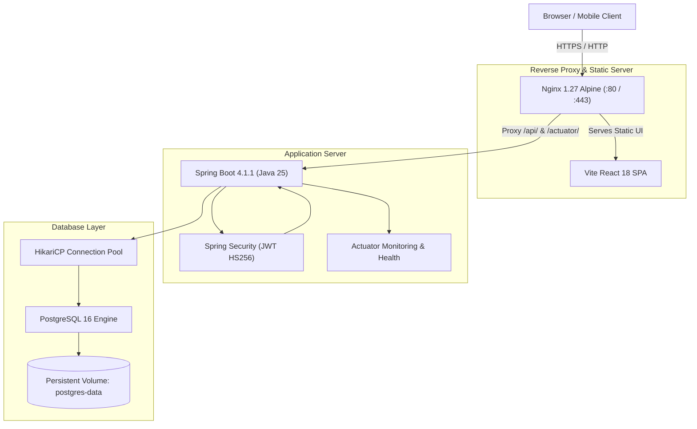

# DecisionHub — Collaborative Decision Intelligence System

[](https://spring.io/projects/spring-boot)
[](https://react.dev)
[](https://openjdk.org)
[](https://www.postgresql.org)
[](https://www.docker.com)
[](https://vitejs.dev)

> **Team 003**: Collaborative Decision Intelligence System for Option Analysis and Community Engagement.  
> An enterprise-grade, full-stack decision-making platform featuring multi-criteria weighted scoring, role-based community governance, real-time analytics, and secure voting workflows.

---

## 📑 Table of Contents
1. [System Architecture](#-system-architecture)
2. [Key Feature Highlights](#-key-feature-highlights)
3. [Technology Stack](#-technology-stack)
4. [Quick Start with Docker Compose](#-quick-start-with-docker-compose)
5. [Local Development Setup](#-local-development-setup)
6. [Production Build & Deployment](#-production-build--deployment)
7. [Environment Variables Reference](#-environment-variables-reference)
8. [Monitoring, Health Checks & Logging](#-monitoring-health-checks--logging)
9. [Pre-Seeded Evaluation Personas](#-pre-seeded-evaluation-personas)
10. [Documentation Index](#-documentation-index)
11. [Repository Structure](#-repository-structure)

---

## 🏛 System Architecture

DecisionHub is engineered as a decoupled modern web application with a stateless backend and responsive Single Page Application (SPA) frontend:



---

## 🌟 Key Feature Highlights

- **5-Factor Multi-Criteria Scoring**: Quantitatively evaluate options across Cost, Benefits, Risk, Time, and Convenience (1–10 scale).
- **Flexible Voting Polls**: Support for Single Choice, Multiple Choice, and Star/Numeric Ratings (1–5 scale) with anonymous secret-ballot support.
- **Role-Based Communities**: Scoped collaboration spaces with granular Owner, Moderator, and Member permissions.
- **Deep Threaded Discussions**: Multi-level nested comment replies, reaction endorsements, and structured improvement suggestions.
- **Content Moderation & Safety**: Community-scoped content reporting, abusive comment hiding, and resolution tracking.
- **Decision Intelligence Analytics**: Aggregated real-time platform metrics, category vote distributions, poll type popularity, and top active boards.
- **Production-Grade Observability**: Spring Boot Actuator health checks (`/actuator/health`), Micrometer metrics, structured log rotation, and Docker healthcheck probes.

---

## 🛠 Technology Stack

| Layer | Component | Description |
| :--- | :--- | :--- |
| **Backend** | Spring Boot 4.1.1 | Enterprise Java framework running on OpenJDK 25 |
| **Security** | Spring Security & JJWT 0.12.6 | Stateless Bearer JWT tokens, BCrypt password hashing |
| **Persistence** | Spring Data JPA / Hibernate | High-performance ORM with PostgreSQL dialect |
| **Connection Pool** | HikariCP | Tuned connection pooling for high-concurrency workloads |
| **Database** | PostgreSQL 16 (Alpine) | ACID-compliant relational persistence |
| **Frontend** | React 18.3 & Vite 5.4 | High-performance SPA with modern CSS modules |
| **Routing & State** | React Router v6 & Context API | Centralized authentication and session management |
| **Web Server** | Nginx 1.27 (Alpine) | Reverse proxy, Gzip compression, TLS termination, HSTS |
| **Containerization** | Docker & Docker Compose | Multi-stage hardened builds with non-root security |

---

## 🚀 Quick Start with Docker Compose

Spin up the entire production-grade stack (PostgreSQL, Spring Boot backend, and React frontend) with a single command:

### 1. Clone & Configure Environment
```bash
git clone https://github.com/springboardmentor632/team-003.git
cd team-003-backend-auth-decision

# Copy the environment template
cp .env.example .env
```
*(The default `.env` includes valid local-development credentials ready for immediate evaluation).*

### 2. Launch the Application
```bash
docker compose up -d --build
```

### 3. Access DecisionHub
- **Web Application**: Open [http://localhost](http://localhost) in your browser.
- **Backend Health Check**: [http://localhost/actuator/health](http://localhost/actuator/health)
- **API Base**: [http://localhost/api](http://localhost/api)

---

## 💻 Local Development Setup

To run backend and frontend independently for local development:

### Backend (Spring Boot)
1. **Prerequisites**: JDK 25 and PostgreSQL 16 running on port 5432.
2. **Navigate & Run**:
   ```bash
   cd backend/springboot-project
   
   # Run tests
   ./mvnw test        # On Linux/macOS
   .\mvnw.cmd test    # On Windows

   # Start Spring Boot application
   ./mvnw spring-boot:run
   ```
   The backend starts at `http://127.0.0.1:8080`.

### Frontend (React & Vite)
1. **Prerequisites**: Node.js 20+ and npm.
2. **Navigate & Run**:
   ```bash
   cd decisionhub-frontend
   npm ci
   npm run dev
   ```
   The frontend dev server starts at `http://127.0.0.1:3000`.

---

## 🚢 Production Build & Deployment

### Production Spring Boot JAR
```bash
cd backend/springboot-project
./mvnw clean package -DskipTests
```
Produces an optimized fat JAR in `target/springboot-project-0.0.1-SNAPSHOT.jar`.

### Production React SPA Build
```bash
cd decisionhub-frontend
npm run build
```
Generates minified, hashed production static assets in `decisionhub-frontend/dist/`.

### HTTPS/SSL Production Deployment
DecisionHub includes a production Compose configuration with SSL termination and automated Certbot renewal:
```bash
# 1. Generate SSL certificates (or use Let's Encrypt)
./scripts/generate-ssl-certs.sh ./nginx/ssl/live localhost

# 2. Launch production stack with HTTPS enabled
docker compose -f docker-compose.prod.yml up -d
```
Access `https://localhost` (or your domain name) with HTTP-to-HTTPS automatic redirection and HSTS security.

---

## ⚙️ Environment Variables Reference

Key environment variables configured in `.env`:

| Variable | Default Value | Description |
| :--- | :--- | :--- |
| `POSTGRES_DB` | `decisionhub` | Target database name |
| `POSTGRES_USER` | `decisionhub` | PostgreSQL database user |
| `POSTGRES_PASSWORD` | *(Required in .env)* | Database user password |
| `JWT_SECRET` | *(Required in .env)* | Cryptographic HMAC-SHA secret for JWT signing |
| `JWT_EXPIRATION` | `86400000` | Token expiration in ms (24 hours) |
| `SPRING_PROFILES_ACTIVE` | `prod` | Active Spring Boot profile (`prod`, `dev`, `test`) |
| `CORS_ALLOWED_ORIGINS` | `http://localhost,http://127.0.0.1` | Comma-separated list of allowed CORS origins |
| `APP_PORT` | `80` | External HTTP port mapped by host |
| `APP_SSL_PORT` | `443` | External HTTPS port mapped by host |
| `MAIL_HOST` | `smtp.example.com` | SMTP hostname for password reset emails |
| `LOG_PATH` | `/app/logs` | Directory path for persistent rolling log files |

---

## 📊 Monitoring, Health Checks & Logging

### Health Probes
- **Liveness & Readiness Probe**: `GET /actuator/health`
  - Validates PostgreSQL database connectivity, HikariCP pool status, and available disk storage.
- **Application Info**: `GET /actuator/info`
- **Application Metrics**: `GET /actuator/metrics`

### Structured Logging
Logs are automatically formatted and routed via `logback-spring.xml`:
- **Console**: Structured ANSI-colored logs for Docker container logging (`docker compose logs -f`).
- **File Appenders**:
  - Combined activity log: `logs/decisionhub-backend.log`
  - Error isolation log: `logs/decisionhub-backend-error.log`
- Configured with `SizeAndTimeBasedRollingPolicy` (max 50MB per file, 60-day retention, 5GB total cap).

---

## 👥 Pre-Seeded Evaluation Personas

For streamlined testing, all pre-seeded accounts share the uniform password **`demo123`**:

| Persona Role | Email | Password | Global Authority |
| :--- | :--- | :--- | :--- |
| **Global Admin** | `admin@decisionhub.local` | `demo123` | `ADMIN` |
| **Community Moderator** | `arjun@decisionhub.local` | `demo123` | `USER` (Moderator of Product Builders) |
| **Community Owner** | `maya@decisionhub.local` | `demo123` | `USER` (Owner of Product Builders) |
| **Active Member** | `harish@decisionhub.local` | `demo123` | `USER` |
| **Standard User** | `priya@decisionhub.local` | `demo123` | `USER` |
| **Standard User** | `rohan@decisionhub.local` | `demo123` | `USER` |

---

## 📚 Documentation Index

For comprehensive implementation, architecture, and operational specifications, consult our detailed documentation guides:

- 📘 [**User Guide**](docs/USER_GUIDE.md): End-user feature walkthrough, multi-factor scoring guide, and role workflows.
- 📙 [**REST API Documentation**](docs/API_DOCUMENTATION.md): Detailed reference covering all 11 modules and 59 endpoints with schemas and samples.
- 📗 [**Database Architecture & Documentation**](docs/DATABASE_DOCUMENTATION.md): Complete ER diagram, data dictionary (15 tables), indexes, and pooling parameters.
- 📕 [**Production Deployment Guide**](docs/DEPLOYMENT_GUIDE.md): Step-by-step VPS deployment, SSL configuration, systemd services, automated backups, and troubleshooting.
- 🔬 [**Testing & Validation Report**](docs/TESTING_VALIDATION_REPORT.md): Comprehensive evaluation report covering unit tests, API tests, frontend tests, RBAC security, voting validation, and concurrency benchmarks.

---

## 📂 Repository Structure

```text
team-003-backend-auth-decision/
├── .github/
│   └── workflows/
│       └── ci.yml                     # Continuous integration build & test pipeline
├── backend/
│   └── springboot-project/
│       ├── src/main/java/com/decisionhub/
│       │   ├── config/                # Security, CORS, and database seed configs
│       │   ├── controller/            # REST controllers (Auth, Decisions, Communities, etc.)
│       │   ├── model/                 # JPA entity models
│       │   ├── repository/            # Spring Data JPA repositories
│       │   ├── security/              # JWT filter and UserDetailsService
│       │   └── service/               # Business domain services
│       ├── src/main/resources/
│       │   ├── application.properties # Base configuration
│       │   ├── application-prod.properties # Production profile overrides
│       │   └── logback-spring.xml     # Structured rolling logging config
│       ├── Dockerfile                 # Hardened non-root Spring Boot container
│       └── pom.xml                    # Maven build dependencies & Actuator
├── database/
│   └── init.sql                       # PostgreSQL schema initialization script
├── decisionhub-frontend/
│   ├── src/
│   │   ├── api/                       # Axios client & REST endpoints
│   │   ├── components/                # Reusable UI components
│   │   ├── context/                   # AuthContext and state providers
│   │   ├── pages/                     # Application screens & views
│   │   └── styles/                    # Design tokens & styling
│   ├── Dockerfile                     # Multi-stage Nginx container build
│   ├── nginx.conf                     # Production Nginx reverse proxy configuration
│   └── package.json                   # React dependencies & scripts
├── deploy/
│   ├── decisionhub-backend.service    # Linux systemd service unit
│   └── systemd-install.sh             # Bare-metal installation script
├── docs/
│   ├── API_DOCUMENTATION.md           # Exhaustive REST API reference
│   ├── DATABASE_DOCUMENTATION.md      # ER diagram & data dictionary
│   ├── DEPLOYMENT_GUIDE.md            # Production deployment manual
│   └── USER_GUIDE.md                  # User & evaluator walkthrough
├── nginx/
│   └── nginx-ssl.conf                 # Production HTTPS/SSL Nginx configuration
├── scripts/
│   ├── backup-db.sh / .ps1            # Automated PostgreSQL backup scripts
│   ├── restore-db.sh / .ps1           # Database restore scripts
│   └── generate-ssl-certs.sh / .ps1   # Self-signed SSL certificate generators
├── .env.example                       # Documented environment variables template
├── docker-compose.yml                 # Standard production compose stack
├── docker-compose.prod.yml            # HTTPS/SSL production compose stack
└── README.md                          # Root project documentation
```

---

## 📄 License
This project is licensed under the MIT License — see the [LICENSE](LICENSE) file for details.
