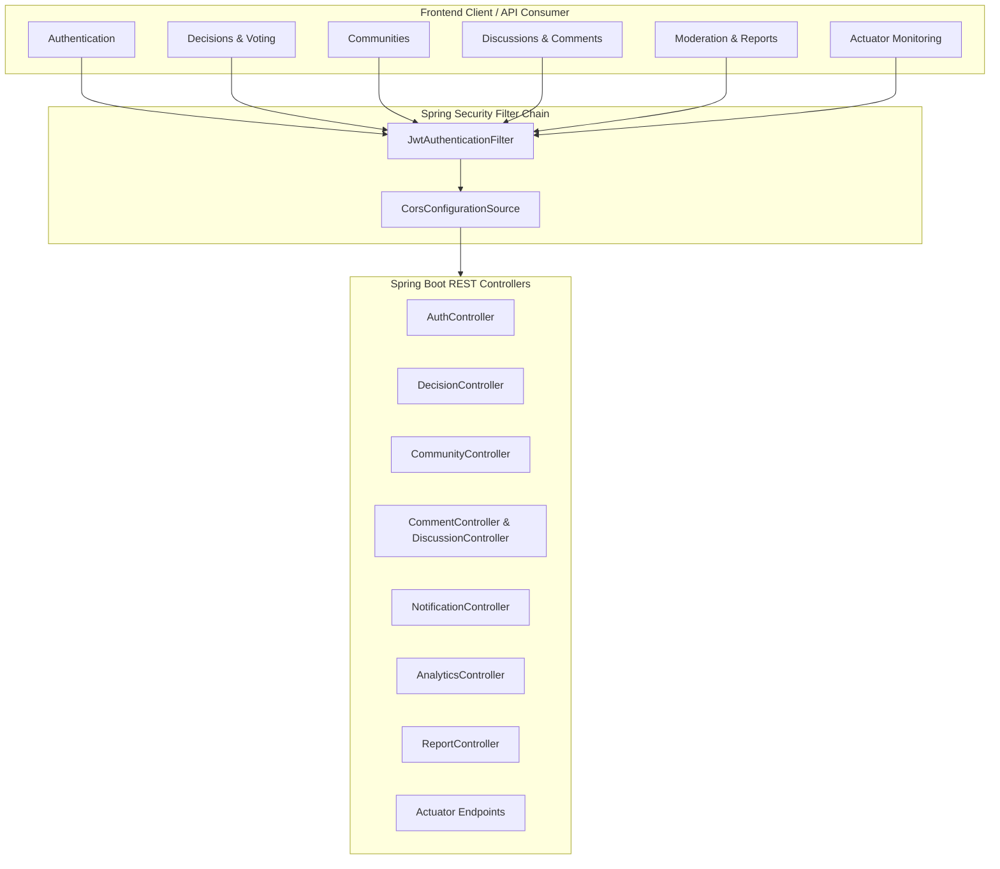

# DecisionHub — Comprehensive REST API Documentation

> **Version**: 1.0.0  
> **Backend Architecture**: Spring Boot 4.1.1 (Java 25) with Spring Security & Spring Data JPA  
> **Security Model**: Stateless Bearer JWT (`HS256`, 24-hour expiration)  
> **Base URLs**:
> - Production: `https://decisionhub.org/api`
> - Local Docker: `http://localhost/api` (proxied via Nginx)
> - Standalone Backend: `http://127.0.0.1:8080/api`

---

## 1. Authentication & Security Architecture

### 1.1 Bearer Token Header
All protected endpoints require the HTTP `Authorization` header formatted as follows:
```http
Authorization: Bearer <jwt-token>
```

### 1.2 Standard Response & Error Format
Standard error responses follow a structured JSON schema:
- **`400 Bad Request`**: Validation or domain business rule violation.
  ```json
  {
    "error": "Title must be between 3 and 255 characters",
    "status": 400,
    "timestamp": "2026-10-04T18:00:00"
  }
  ```
- **`401 Unauthorized`**: Missing, malformed, or expired JWT token.
- **`403 Forbidden`**: Insufficient permissions for the requested action (e.g., non-moderator trying to view reports).
  ```json
  {
    "error": "Moderator access is required"
  }
  ```
- **`404 Not Found`**: Resource ID does not exist.
  ```json
  {
    "error": "Decision not found with id: 42"
  }
  ```

### 1.3 Pre-Seeded Evaluation Personas
| Persona | Email | Password | Global Role | Community Privileges |
| :--- | :--- | :--- | :--- | :--- |
| **Global Admin** | `admin@decisionhub.local` | `demo123` | `ADMIN` | Superuser across all communities and moderation queues |
| **Community Moderator** | `arjun@decisionhub.local` | `demo123` | `USER` | Owner of *Engineering Circle*; Moderator of *Product Builders* |
| **Community Owner** | `maya@decisionhub.local` | `demo123` | `USER` | Owner of *Product Builders* & *Weekend Explorers* |
| **Active Member** | `harish@decisionhub.local` | `demo123` | `USER` | Member across multiple communities |
| **Standard User** | `priya@decisionhub.local` | `demo123` | `USER` | Owner of *Workplace & Culture* |
| **Standard User** | `rohan@decisionhub.local` | `demo123` | `USER` | Owner of *Sustainable Choices* |

---

## 2. API Endpoint Catalog



---

## Module 1: Authentication & User Management

### 1.1 Register New User
- **Method**: `POST`
- **URL**: `/api/auth/register`
- **Access**: Public
- **Request Body**:
  ```json
  {
    "name": "Alex Mercer",
    "email": "alex@decisionhub.local",
    "password": "SecurePassword123!"
  }
  ```
- **Response**: `200 OK`
  ```json
  {
    "token": "eyJhbGciOiJIUzI1NiJ9.eyJzdWIiOiJhbGV4QGRlY2lzaW9uaHViLmxvY2FsIiwicm9sZSI6IlVTRVIi...",
    "name": "Alex Mercer",
    "email": "alex@decisionhub.local",
    "role": "USER"
  }
  ```

### 1.2 User Login
- **Method**: `POST`
- **URL**: `/api/auth/login`
- **Access**: Public
- **Request Body**:
  ```json
  {
    "email": "admin@decisionhub.local",
    "password": "demo123"
  }
  ```
- **Response**: `200 OK`
  ```json
  {
    "token": "eyJhbGciOiJIUzI1NiJ9...",
    "name": "System Admin",
    "email": "admin@decisionhub.local",
    "role": "ADMIN"
  }
  ```

### 1.3 Quick Demo Admin Token
- **Method**: `GET`
- **URL**: `/api/auth/demo-admin`
- **Access**: Public (Demo & Evaluation Utility)
- **Response**: `200 OK` (Returns direct signed token for System Admin)

### 1.4 Password Reset Request
- **Method**: `POST`
- **URL**: `/api/auth/password-reset/request`
- **Access**: Public
- **Request Body**:
  ```json
  {
    "email": "user@example.com"
  }
  ```
- **Response**: `200 OK`
  ```json
  {
    "message": "If the account exists, a password reset email has been dispatched."
  }
  ```

### 1.5 Password Reset Confirmation
- **Method**: `POST`
- **URL**: `/api/auth/password-reset/confirm`
- **Access**: Public
- **Request Body**:
  ```json
  {
    "token": "64-character-sha256-hex-token",
    "newPassword": "NewSecurePassword2026!"
  }
  ```
- **Response**: `200 OK`
  ```json
  {
    "message": "Password successfully reset. You may now log in with your new credentials."
  }
  ```

### 1.6 Current User Profile
- **Method**: `GET`
- **URL**: `/api/users/me`
- **Access**: Bearer Token Required
- **Response**: `200 OK`
  ```json
  {
    "id": 1,
    "name": "System Admin",
    "email": "admin@decisionhub.local",
    "role": "ADMIN"
  }
  ```

---

## Module 2: Decision Boards, Options & Voting

### 2.1 List Public Decision Boards
- **Method**: `GET`
- **URL**: `/api/decisions/public?page=0&size=20&category=`
- **Access**: Bearer Token Required
- **Query Parameters**:
  - `page`: zero-based page index (default: `0`)
  - `size`: items per page (default: `20`)
  - `category`: optional category filter (e.g. `Technology`, `Operations`, `Culture`)
- **Response**: `200 OK` (Spring Data Page representation)

### 2.2 List Current User's Decision Boards
- **Method**: `GET`
- **URL**: `/api/decisions/mine?page=0&size=20`
- **Access**: Bearer Token Required

### 2.3 List Decisions by Community
- **Method**: `GET`
- **URL**: `/api/decisions/community/{communityId}`
- **Access**: Bearer Token Required

### 2.4 Get Decision Board by ID
- **Method**: `GET`
- **URL**: `/api/decisions/{id}`
- **Access**: Bearer Token Required
- **Response**: `200 OK`
  ```json
  {
    "id": 1,
    "title": "Cloud Infrastructure Provider Selection",
    "description": "Evaluation of AWS vs GCP vs Azure for 2026 platform architecture.",
    "createdBy": "System Admin",
    "category": "Technology",
    "visibility": "PUBLIC",
    "pollType": "SINGLE_CHOICE",
    "allowAnonymousVoting": false,
    "closed": false,
    "communityId": 1,
    "totalVotes": 14,
    "options": [
      {
        "id": 1,
        "name": "AWS (Amazon Web Services)",
        "description": "Industry leading mature cloud with AWS EKS and Aurora.",
        "pros": "Broadest toolset, extensive managed services.",
        "cons": "Higher egress bandwidth costs.",
        "costScore": 6,
        "benefitsScore": 9,
        "riskScore": 4,
        "timeScore": 8,
        "convenienceScore": 8,
        "voteCount": 8,
        "averageRating": 4.2
      }
    ],
    "createdAt": "2026-09-25T14:30:00",
    "updatedAt": "2026-09-25T14:30:00"
  }
  ```

### 2.5 Create Decision Board
- **Method**: `POST`
- **URL**: `/api/decisions`
- **Access**: Bearer Token Required
- **Request Body**:
  ```json
  {
    "title": "Microservices Framework Selection",
    "description": "Standardize team stack for internal services.",
    "category": "Engineering",
    "visibility": "PUBLIC",
    "pollType": "RATING",
    "allowAnonymousVoting": true,
    "communityId": 2,
    "options": [
      {
        "name": "Spring Boot 4",
        "description": "Enterprise Java standard with Actuator and Virtual Threads.",
        "costScore": 7,
        "benefitsScore": 9,
        "riskScore": 3,
        "timeScore": 8,
        "convenienceScore": 9
      },
      {
        "name": "Go (Gin / Fiber)",
        "description": "Ultra lightweight compiled binary services.",
        "costScore": 9,
        "benefitsScore": 8,
        "riskScore": 5,
        "timeScore": 7,
        "convenienceScore": 7
      }
    ]
  }
  ```
- **Response**: `201 Created`

### 2.6 Update Decision Board
- **Method**: `PUT`
- **URL**: `/api/decisions/{id}`
- **Access**: Board Owner or Global Admin
- **Request Body**:
  ```json
  {
    "title": "Updated Decision Title",
    "description": "Updated rationale",
    "closed": true
  }
  ```

### 2.7 Delete Decision Board
- **Method**: `DELETE`
- **URL**: `/api/decisions/{id}`
- **Access**: Board Owner or Global Admin
- **Response**: `204 No Content`

### 2.8 Cast Vote
- **Method**: `POST`
- **URL**: `/api/decisions/{id}/votes`
- **Access**: Bearer Token Required
- **Request Body**:
  ```json
  {
    "optionId": 1,
    "rating": 5,
    "anonymous": false
  }
  ```
- **Response**: `200 OK`

### 2.9 Retract Vote
- **Method**: `DELETE`
- **URL**: `/api/decisions/{id}/votes/{optionId}`
- **Access**: Bearer Token Required
- **Response**: `200 OK`

---

## Module 3: Communities, Roles & Invitations

### 3.1 List All Communities
- **Method**: `GET`
- **URL**: `/api/communities`
- **Access**: Bearer Token Required
- **Response**: `200 OK` (Array with `id`, `name`, `description`, `owner`, `memberCount`, `joined`, `memberRole`)

### 3.2 Create Community
- **Method**: `POST`
- **URL**: `/api/communities`
- **Access**: Bearer Token Required
- **Request Body**:
  ```json
  {
    "name": "Cloud Native Architecture",
    "description": "Discussion and RFC voting for Kubernetes and microservice standards."
  }
  ```
- **Response**: `201 Created` (Creator automatically assigned `OWNER` role)

### 3.3 Get Community Details & Members
- **Method**: `GET`
- **URL**: `/api/communities/{id}`
- **Access**: Bearer Token Required

### 3.4 Join Community
- **Method**: `POST`
- **URL**: `/api/communities/{id}/members`
- **Access**: Bearer Token Required

### 3.5 Leave Community
- **Method**: `DELETE`
- **URL**: `/api/communities/{id}/members/me`
- **Access**: Bearer Token Required

### 3.6 Change Member Role
- **Method**: `PUT`
- **URL**: `/api/communities/{id}/members/{memberId}/role?role=MODERATOR`
- **Access**: Community Owner or Global Admin

### 3.7 Send Community Invitation
- **Method**: `POST`
- **URL**: `/api/communities/{id}/invitations?email=harish@decisionhub.local`
- **Access**: Community Owner, Moderator, or Admin

### 3.8 List Pending Invitations
- **Method**: `GET`
- **URL**: `/api/communities/invitations`
- **Access**: Bearer Token Required

### 3.9 Accept / Decline Invitation
- **Accept**: `POST /api/communities/invitations/{id}/accept`
- **Decline**: `POST /api/communities/invitations/{id}/decline`

---

## Module 4: Threaded Comments & Discussion

### 4.1 Get Decision Comments
- **Method**: `GET`
- **URL**: `/api/decisions/{decisionId}/comments`
- **Access**: Bearer Token Required (Hidden comments automatically filtered for non-moderators)

### 4.2 Post Top-Level Comment or Reply
- **Method**: `POST`
- **URL**: `/api/decisions/{decisionId}/comments`
- **Request Body**:
  ```json
  {
    "body": "The latency benchmarks on AWS EKS show consistent sub-5ms p99.",
    "parentId": null
  }
  ```

### 4.3 Like / React to Comment
- **Method**: `POST`
- **URL**: `/api/decisions/{decisionId}/comments/{commentId}/reactions`

### 4.4 Hide / Moderate Comment
- **Method**: `PUT`
- **URL**: `/api/decisions/{decisionId}/comments/{commentId}/hidden?value=true`
- **Access**: Moderator, Community Owner, or Global Admin

---

## Module 5: Standalone Discussion Forum

- `GET /api/discussions`: List global discussion threads
- `GET /api/discussions/mine`: Threads created by current user
- `GET /api/discussions/{id}`: Single thread with details
- `POST /api/discussions?title=...&content=...`: Create discussion thread
- `DELETE /api/discussions/{id}`: Creator or Admin
- `GET /api/discussions/{id}/comments`: Thread replies
- `POST /api/discussions/{id}/comments?content=...&parentCommentId=`: Post reply

---

## Module 6: Improvement Suggestions

- `GET /api/decisions/{decisionId}/suggestions`: List suggestions for decision
- `POST /api/decisions/{decisionId}/suggestions`: Submit suggestion
  ```json
  {
    "content": "Consider adding automated cost anomaly detection criteria."
  }
  ```

---

## Module 7: Notifications & Summary

- `GET /api/notifications`: List all user notifications
- `GET /api/notifications/summary`: Unread counter (`{"unread": 3}`)
- `POST /api/notifications/{id}/read`: Mark single notification read
- `POST /api/notifications/read-all`: Mark all notifications read
- `POST /api/notifications/system?email=...&message=...`: Admin broadcast

---

## Module 8: Analytics & Insights

### 8.1 Decision Intelligence Summary
- **Method**: `GET`
- **URL**: `/api/analytics/summary`
- **Access**: Bearer Token Required
- **Response**: `200 OK`
  ```json
  {
    "totalBoards": 12,
    "totalVotes": 74,
    "totalComments": 48,
    "activeCommunities": 5,
    "categoryVotes": {
      "Technology": 38,
      "Product": 22,
      "Culture": 14
    },
    "pollTypes": {
      "SINGLE_CHOICE": 7,
      "RATING": 5
    },
    "outcomes": {
      "OPEN": 9,
      "CLOSED": 3
    }
  }
  ```

---

## Module 9: User Feedback

- `POST /api/feedback`: Submit application feedback
- `GET /api/feedback`: Current user's feedback
- `GET /api/feedback/all`: Admin/Moderator view
- `PUT /api/feedback/{id}/status?status=REVIEWED`: Update status (`OPEN` -> `REVIEWED` -> `RESOLVED`)

---

## Module 10: Content Moderation & Reports

- `POST /api/decisions/{decisionId}/reports`: Report board or comment
  ```json
  {
    "reason": "Off-topic solicitation content",
    "commentId": null
  }
  ```
- `GET /api/reports`: List pending reports (Moderators & Admins only; `403` for members)
- `PUT /api/reports/{id}?status=RESOLVED`: Resolve or dismiss report

---

## Module 11: Production Actuator Health & Monitoring

- `GET /actuator/health`: System liveness and readiness probe
  ```json
  {
    "status": "UP",
    "components": {
      "db": {
        "status": "UP",
        "details": {
          "database": "PostgreSQL",
          "validationQuery": "isValid()"
        }
      },
      "diskSpace": {
        "status": "UP",
        "details": {
          "free": 45192837120,
          "threshold": 10485760
        }
      },
      "ping": {
        "status": "UP"
      }
    }
  }
  ```
- `GET /actuator/info`: Application version, profile, and metadata
- `GET /actuator/metrics`: JVM memory, thread pool, and HTTP request metrics
