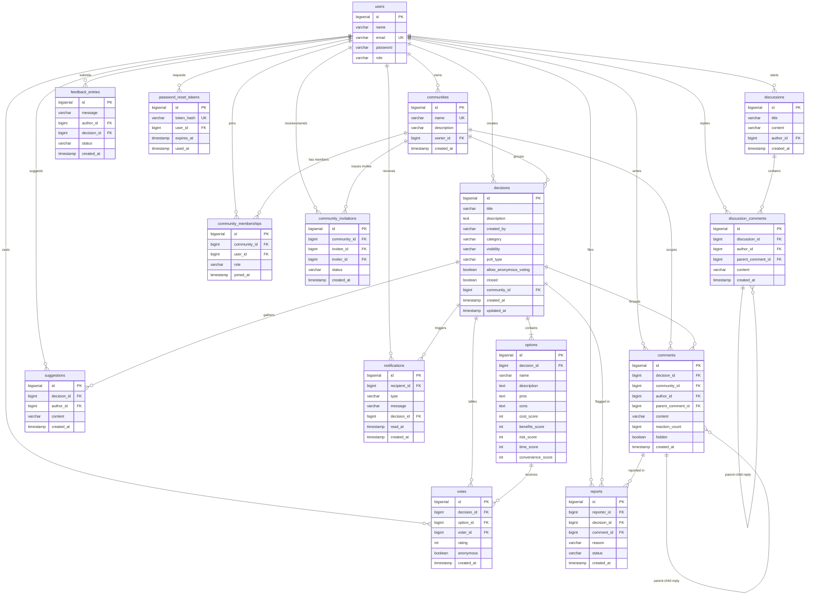

# DecisionHub — Database Architecture & Schema Documentation

> **Database Engine**: PostgreSQL 16 (Alpine Linux containerized / Standalone)  
> **Default Database**: `decisionhub`  
> **Schema Engine**: Relational, UTF-8 character encoding, Read Committed isolation level  
> **Connection Pool**: HikariCP (High-performance JDBC connection pool)

---

## 1. Entity-Relationship (ER) Diagram



---

## 2. Comprehensive Data Dictionary (15 Relational Tables)

### Table 1: `users`
Stores user identities, login credentials, and global system roles.

| Column | Type | Constraints | Description |
| :--- | :--- | :--- | :--- |
| `id` | `BIGSERIAL` | `PRIMARY KEY` | Unique synthetic identity |
| `name` | `VARCHAR(255)` | `NULLABLE` | User's full display name |
| `email` | `VARCHAR(255)` | `NOT NULL, UNIQUE` | Unique email for authentication |
| `password` | `VARCHAR(255)` | `NOT NULL` | BCrypt-hashed password string |
| `role` | `VARCHAR(50)` | `NOT NULL DEFAULT 'USER'` | Global authority: `'USER'` or `'ADMIN'` |

---

### Table 2: `communities`
Groups of users collaborating on shared domain decisions.

| Column | Type | Constraints | Description |
| :--- | :--- | :--- | :--- |
| `id` | `BIGSERIAL` | `PRIMARY KEY` | Unique community identifier |
| `name` | `VARCHAR(255)` | `NOT NULL, UNIQUE` | Distinct community label |
| `description` | `VARCHAR(2000)` | `NULLABLE` | Mission and scope statement |
| `owner_id` | `BIGINT` | `NOT NULL, FK -> users(id)` | Creator / Administrator user ID |
| `created_at` | `TIMESTAMP` | `NOT NULL DEFAULT NOW()` | Creation timestamp |

---

### Table 3: `community_memberships`
Join table recording user participation and role inside communities.

| Column | Type | Constraints | Description |
| :--- | :--- | :--- | :--- |
| `id` | `BIGSERIAL` | `PRIMARY KEY` | Primary key |
| `community_id` | `BIGINT` | `NOT NULL, FK -> communities(id)` | Linked community |
| `user_id` | `BIGINT` | `NOT NULL, FK -> users(id)` | Linked member user |
| `role` | `VARCHAR(20)` | `DEFAULT 'MEMBER'` | Role: `'OWNER'`, `'MODERATOR'`, `'MEMBER'` |
| `joined_at` | `TIMESTAMP` | `NOT NULL DEFAULT NOW()` | Membership enrollment timestamp |

*Unique Constraint*: `uk_community_member (community_id, user_id)`

---

### Table 4: `community_invitations`
Invitations sent to prospective members by community moderators/owners.

| Column | Type | Constraints | Description |
| :--- | :--- | :--- | :--- |
| `id` | `BIGSERIAL` | `PRIMARY KEY` | Primary key |
| `community_id` | `BIGINT` | `NOT NULL, FK -> communities(id)` | Inviting community |
| `invitee_id` | `BIGINT` | `NOT NULL, FK -> users(id)` | Invited user recipient |
| `inviter_id` | `BIGINT` | `NOT NULL, FK -> users(id)` | User who dispatched invitation |
| `status` | `VARCHAR(50)` | `NOT NULL DEFAULT 'PENDING'` | Status: `'PENDING'`, `'ACCEPTED'`, `'DECLINED'` |
| `created_at` | `TIMESTAMP` | `NOT NULL DEFAULT NOW()` | Dispatched timestamp |

---

### Table 5: `decisions`
Core entity representing an analytical decision board or voting initiative.

| Column | Type | Constraints | Description |
| :--- | :--- | :--- | :--- |
| `id` | `BIGSERIAL` | `PRIMARY KEY` | Decision board ID |
| `title` | `VARCHAR(255)` | `NOT NULL` | Decision title |
| `description` | `TEXT` | `NULLABLE` | Context, goals, and problem formulation |
| `created_by` | `VARCHAR(255)` | `NULLABLE` | Author display name / identity |
| `category` | `VARCHAR(100)` | `NOT NULL DEFAULT 'General'` | Domain: Technology, Product, Operations, etc. |
| `visibility` | `VARCHAR(50)` | `NOT NULL DEFAULT 'PUBLIC'` | `'PUBLIC'`, `'COMMUNITY'`, or `'PRIVATE'` |
| `poll_type` | `VARCHAR(50)` | `NOT NULL DEFAULT 'SINGLE_CHOICE'` | `'SINGLE_CHOICE'`, `'MULTIPLE_CHOICE'`, `'RATING'` |
| `allow_anonymous_voting` | `BOOLEAN` | `NOT NULL DEFAULT FALSE` | Flag enabling secret ballot |
| `closed` | `BOOLEAN` | `NOT NULL DEFAULT FALSE` | If true, voting and comments are frozen |
| `community_id` | `BIGINT` | `FK -> communities(id)` | Community boundary (nullable) |
| `created_at` | `TIMESTAMP` | `NOT NULL DEFAULT NOW()` | Board creation timestamp |
| `updated_at` | `TIMESTAMP` | `NOT NULL DEFAULT NOW()` | Last update timestamp |

---

### Table 6: `options`
Mutually exclusive or rated choices evaluated within a decision board.

| Column | Type | Constraints | Description |
| :--- | :--- | :--- | :--- |
| `id` | `BIGSERIAL` | `PRIMARY KEY` | Option ID |
| `decision_id` | `BIGINT` | `NOT NULL, FK -> decisions(id)` | Parent decision board |
| `name` | `VARCHAR(255)` | `NOT NULL` | Option title / alternative name |
| `description` | `TEXT` | `NULLABLE` | Narrative description of the alternative |
| `pros` | `TEXT` | `NULLABLE` | Strengths and advantages |
| `cons` | `TEXT` | `NULLABLE` | Risks and drawbacks |
| `cost_score` | `INTEGER` | `NULLABLE` | Multi-factor: Cost rating (1-10) |
| `benefits_score`| `INTEGER` | `NULLABLE` | Multi-factor: Benefits rating (1-10) |
| `risk_score` | `INTEGER` | `NULLABLE` | Multi-factor: Risk factor (1-10) |
| `time_score` | `INTEGER` | `NULLABLE` | Multi-factor: Implementation speed (1-10) |
| `convenience_score` | `INTEGER` | `NULLABLE` | Multi-factor: Usability / UX (1-10) |

---

### Table 7: `votes`
Audit record of cast ballots and ratings.

| Column | Type | Constraints | Description |
| :--- | :--- | :--- | :--- |
| `id` | `BIGSERIAL` | `PRIMARY KEY` | Ballot vote ID |
| `decision_id` | `BIGINT` | `NOT NULL, FK -> decisions(id)` | Target decision |
| `option_id` | `BIGINT` | `NOT NULL, FK -> options(id)` | Selected alternative |
| `voter_id` | `BIGINT` | `NOT NULL, FK -> users(id)` | Participating user |
| `rating` | `INTEGER` | `NULLABLE` | Score for rating polls (1-5) |
| `anonymous` | `BOOLEAN` | `NOT NULL DEFAULT FALSE` | Whether voter identity is concealed |
| `created_at` | `TIMESTAMP` | `NOT NULL DEFAULT NOW()` | Cast timestamp |

*Unique Constraint*: `uk_vote_decision_option_user (decision_id, option_id, voter_id)`

---

### Table 8: `comments`
Threaded discussion comments and nested replies attached to decision boards.

| Column | Type | Constraints | Description |
| :--- | :--- | :--- | :--- |
| `id` | `BIGSERIAL` | `PRIMARY KEY` | Comment ID |
| `decision_id` | `BIGINT` | `NOT NULL, FK -> decisions(id)` | Parent decision |
| `community_id`| `BIGINT` | `FK -> communities(id)` | Community scope |
| `author_id` | `BIGINT` | `NOT NULL, FK -> users(id)` | Comment author |
| `parent_comment_id` | `BIGINT` | `FK -> comments(id)` | Null for top-level, self-referential for reply |
| `content` | `VARCHAR(3000)` | `NOT NULL` | Comment markdown / text body |
| `reaction_count` | `BIGINT` | `NOT NULL DEFAULT 0` | Likes / positive reactions |
| `hidden` | `BOOLEAN` | `NOT NULL DEFAULT FALSE` | Moderator suppression flag |
| `created_at` | `TIMESTAMP` | `NOT NULL DEFAULT NOW()` | Publication timestamp |

---

### Table 9: `discussions`
Platform-wide open forum discussion threads.

| Column | Type | Constraints | Description |
| :--- | :--- | :--- | :--- |
| `id` | `BIGSERIAL` | `PRIMARY KEY` | Discussion thread ID |
| `title` | `VARCHAR(200)` | `NOT NULL` | Thread subject header |
| `content` | `VARCHAR(5000)` | `NOT NULL` | Initial discussion post |
| `author_id` | `BIGINT` | `NOT NULL, FK -> users(id)` | Thread creator |
| `created_at` | `TIMESTAMP` | `NOT NULL DEFAULT NOW()` | Post timestamp |

---

### Table 10: `discussion_comments`
Threaded replies to standalone forum discussions.

| Column | Type | Constraints | Description |
| :--- | :--- | :--- | :--- |
| `id` | `BIGSERIAL` | `PRIMARY KEY` | Reply ID |
| `discussion_id` | `BIGINT` | `NOT NULL, FK -> discussions(id)` | Parent discussion thread |
| `author_id` | `BIGINT` | `NOT NULL, FK -> users(id)` | Reply author |
| `parent_comment_id` | `BIGINT` | `FK -> discussion_comments(id)` | Nested reply parent |
| `content` | `VARCHAR(3000)` | `NOT NULL` | Reply message body |
| `created_at` | `TIMESTAMP` | `NOT NULL DEFAULT NOW()` | Publication timestamp |

---

### Table 11: `suggestions`
Collaborative proposals submitted by members to enhance decision criteria or options.

| Column | Type | Constraints | Description |
| :--- | :--- | :--- | :--- |
| `id` | `BIGSERIAL` | `PRIMARY KEY` | Suggestion ID |
| `decision_id` | `BIGINT` | `NOT NULL, FK -> decisions(id)` | Target decision |
| `author_id` | `BIGINT` | `NOT NULL, FK -> users(id)` | Suggestion author |
| `content` | `VARCHAR(3000)` | `NOT NULL` | Suggestion text |
| `created_at` | `TIMESTAMP` | `NOT NULL DEFAULT NOW()` | Submission timestamp |

---

### Table 12: `feedback_entries`
User-submitted feedback on the product or specific decision processes.

| Column | Type | Constraints | Description |
| :--- | :--- | :--- | :--- |
| `id` | `BIGSERIAL` | `PRIMARY KEY` | Feedback ID |
| `message` | `VARCHAR(3000)` | `NOT NULL` | Feedback message |
| `author_id` | `BIGINT` | `NOT NULL, FK -> users(id)` | Submitter user ID |
| `decision_id` | `BIGINT` | `FK -> decisions(id)` | Optional linked decision |
| `status` | `VARCHAR(30)` | `NOT NULL DEFAULT 'OPEN'` | `'OPEN'`, `'REVIEWED'`, `'RESOLVED'` |
| `created_at` | `TIMESTAMP` | `NOT NULL DEFAULT NOW()` | Submission timestamp |

---

### Table 13: `reports`
Moderation flags raised against offending decision boards or abusive comments.

| Column | Type | Constraints | Description |
| :--- | :--- | :--- | :--- |
| `id` | `BIGSERIAL` | `PRIMARY KEY` | Report incident ID |
| `reporter_id` | `BIGINT` | `NOT NULL, FK -> users(id)` | User filing the flag |
| `decision_id` | `BIGINT` | `NOT NULL, FK -> decisions(id)` | Associated decision board |
| `comment_id` | `BIGINT` | `FK -> comments(id)` | Specific offending comment (if any) |
| `reason` | `VARCHAR(2000)` | `NOT NULL` | Explanation of violation |
| `status` | `VARCHAR(50)` | `NOT NULL DEFAULT 'PENDING'` | `'PENDING'`, `'RESOLVED'`, `'DISMISSED'` |
| `created_at` | `TIMESTAMP` | `NOT NULL DEFAULT NOW()` | Incident creation timestamp |

*Unique Constraint*: `uk_reporter_decision (reporter_id, decision_id)`

---

### Table 14: `notifications`
In-app alerts notifying users of votes, comments, invitations, and moderation notices.

| Column | Type | Constraints | Description |
| :--- | :--- | :--- | :--- |
| `id` | `BIGSERIAL` | `PRIMARY KEY` | Notification event ID |
| `recipient_id` | `BIGINT` | `NOT NULL, FK -> users(id)` | User receiving notification |
| `type` | `VARCHAR(50)` | `NOT NULL DEFAULT 'GENERAL'` | Enum: `VOTE`, `COMMENT`, `INVITATION`, `SYSTEM` |
| `message` | `VARCHAR(2000)` | `NOT NULL` | Human-readable notification text |
| `decision_id` | `BIGINT` | `FK -> decisions(id)` | Optional deep-link decision ID |
| `read_at` | `TIMESTAMP` | `NULLABLE` | Timestamp when user viewed alert |
| `created_at` | `TIMESTAMP` | `NOT NULL DEFAULT NOW()` | Timestamp event was triggered |

---

### Table 15: `password_reset_tokens`
Cryptographically secure single-use tokens for self-service password recovery.

| Column | Type | Constraints | Description |
| :--- | :--- | :--- | :--- |
| `id` | `BIGSERIAL` | `PRIMARY KEY` | Token record ID |
| `token_hash` | `VARCHAR(64)` | `NOT NULL, UNIQUE` | SHA-256 hash of raw reset token |
| `user_id` | `BIGINT` | `NOT NULL, FK -> users(id)` | Target user account |
| `expires_at` | `TIMESTAMP` | `NOT NULL` | Expiration deadline (default: +30 min) |
| `used_at` | `TIMESTAMP` | `NULLABLE` | Invalidation timestamp upon redemption |

---

## 3. High-Performance Indexing Strategy

To support high-concurrency production read and write workloads, DecisionHub defines indexes across primary access paths:

```sql
-- Fast credential lookup
CREATE INDEX idx_users_email ON users(email);

-- Board exploration and category filtering
CREATE INDEX idx_decisions_visibility ON decisions(visibility);
CREATE INDEX idx_decisions_category ON decisions(category);
CREATE INDEX idx_decisions_created_at ON decisions(created_at DESC);
CREATE INDEX idx_decisions_community_id ON decisions(community_id);

-- Option scoring and vote tallying
CREATE INDEX idx_options_decision_id ON options(decision_id);
CREATE INDEX idx_votes_decision ON votes(decision_id);
CREATE INDEX idx_votes_option ON votes(option_id);
CREATE INDEX idx_votes_voter ON votes(voter_id);

-- Comment threading retrieval
CREATE INDEX idx_comments_decision ON comments(decision_id);
CREATE INDEX idx_comments_parent ON comments(parent_comment_id);

-- Unread notification partial index (zero footprint for read notifications)
CREATE INDEX idx_notifications_unread ON notifications(recipient_id, read_at) WHERE read_at IS NULL;
```

---

## 4. Connection Pooling Configuration (HikariCP)

For production scalability, the backend utilizes HikariCP with optimized sizing parameters:

$$\text{Maximum Pool Size} = (\text{CPU Cores} \times 2) + \text{Disk Spindles} \approx 20$$

```properties
spring.datasource.hikari.maximum-pool-size=20
spring.datasource.hikari.minimum-idle=5
spring.datasource.hikari.connection-timeout=30000
spring.datasource.hikari.idle-timeout=300000
spring.datasource.hikari.max-lifetime=1800000
spring.datasource.hikari.pool-name=DecisionHub-Prod-HikariPool
```

---

## 5. Automated Backup & Recovery Procedures

### 5.1 Automated Daily Backup
Automated backups run via `scripts/backup-db.sh` (or `scripts/backup-db.ps1`):
```bash
./scripts/backup-db.sh
```
- Performs a non-locking `pg_dump` with `--clean --if-exists`.
- Streams directly through `gzip` compression.
- Automatically purges backups older than the 14-day retention threshold.

### 5.2 Database Restoration
To restore a snapshot in staging or disaster recovery:
```bash
./scripts/restore-db.sh backups/decisionhub_backup_20261004_180000.sql.gz
```
