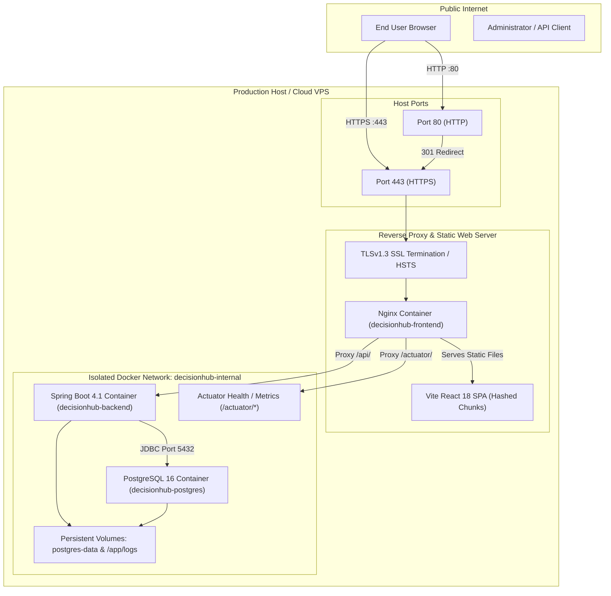

# DecisionHub — Production Deployment & Operations Guide

> **System**: DecisionHub Production Deployment Architecture  
> **Deployment Targets**: Docker Compose (Recommended) or Standalone Systemd / Nginx  
> **Supported OS**: Ubuntu 22.04/24.04 LTS, Debian 12, RHEL 9, macOS, Windows Server  

---

## 1. Production Architecture Overview

The DecisionHub production deployment model decouples client presentation, business logic orchestration, and relational persistence within an isolated internal Docker bridge network:



---

## 2. Server Prerequisites & Host Hardening

### 2.1 Minimum Recommended Hardware
- **CPU**: 2 vCPU cores
- **RAM**: 4 GB (minimum 2 GB with swap)
- **Disk**: 40 GB NVMe / SSD
- **OS**: Ubuntu 22.04 LTS or 24.04 LTS 64-bit

### 2.2 Installing Docker & Docker Compose Plugin
```bash
# Update package repositories
sudo apt-get update && sudo apt-get install -y ca-certificates curl gnupg lsb-release

# Add Docker official GPG key
sudo install -m 0755 -d /etc/apt/keyrings
curl -fsSL https://download.docker.com/linux/ubuntu/gpg | sudo gpg --dearmor -o /etc/apt/keyrings/docker.gpg
sudo chmod a+r /etc/apt/keyrings/docker.gpg

# Set up repository
echo "deb [arch=$(dpkg --print-architecture) signed-by=/etc/apt/keyrings/docker.gpg] https://download.docker.com/linux/ubuntu $(lsb_release -cs) stable" | \
  sudo tee /etc/apt/sources.list.d/docker.list > /dev/null

# Install Docker engine and Compose plugin
sudo apt-get update && sudo apt-get install -y docker-ce docker-ce-cli containerd.io docker-buildx-plugin docker-compose-plugin

# Enable and start Docker service
sudo systemctl enable --now docker
```

### 2.3 Firewall Configuration (UFW)
Expose only SSH, HTTP, and HTTPS to the public internet. Ensure PostgreSQL (5432) and Spring Boot (8080) are never exposed directly on public interfaces:
```bash
sudo ufw default deny incoming
sudo ufw default allow outgoing
sudo ufw allow 22/tcp    # SSH
sudo ufw allow 80/tcp    # HTTP
sudo ufw allow 443/tcp   # HTTPS
sudo ufw enable
```

---

## 3. Containerized Deployment (Recommended)

### 3.1 Clone the Repository & Configure Secrets
```bash
git clone https://github.com/springboardmentor632/team-003.git /opt/decisionhub
cd /opt/decisionhub

# Create production environment configuration
cp .env.example .env
```

### 3.2 Generating Secure Production Credentials
Run the following commands to populate cryptographically strong secrets in `.env`:
```bash
# Generate 256-bit database password
openssl rand -base64 24

# Generate 384-bit JWT secret key
openssl rand -base64 48
```
Edit `.env` using your preferred editor:
```ini
POSTGRES_DB=decisionhub
POSTGRES_USER=decisionhub
POSTGRES_PASSWORD=generated-db-password-here
JWT_SECRET=generated-jwt-secret-here
SPRING_PROFILES_ACTIVE=prod
MAIL_HOST=smtp.sendgrid.net
MAIL_PORT=587
MAIL_USERNAME=apikey
MAIL_PASSWORD=your-sendgrid-api-key
MAIL_SMTP_AUTH=true
MAIL_STARTTLS=true
PASSWORD_RESET_FROM=notifications@yourdomain.com
PASSWORD_RESET_URL=https://yourdomain.com/reset-password
CORS_ALLOWED_ORIGINS=https://yourdomain.com,https://www.yourdomain.com
APP_PORT=80
APP_SSL_PORT=443
```

### 3.3 Launching the Application
```bash
# Build images and start containers in the background
docker compose up -d --build
```

### 3.4 Verifying Service Health
Check container states and health probes:
```bash
docker compose ps
```
Expected output:
```text
NAME                   IMAGE                               STATUS                  PORTS
decisionhub-postgres   postgres:16-alpine                  Up (healthy)            5432/tcp
decisionhub-backend    team-003-decisionhub-backend        Up (healthy)            8080/tcp
decisionhub-frontend   team-003-decisionhub-frontend       Up (healthy)            0.0.0.0:80->80/tcp
```

Test application liveness via curl:
```bash
curl -f http://localhost/actuator/health
```
Response:
```json
{"status":"UP","components":{"db":{"status":"UP"},"diskSpace":{"status":"UP"},"ping":{"status":"UP"}}}
```

---

## 4. HTTPS / SSL Production Setup

### Option A: Let's Encrypt Free SSL (Production Domain)
1. Ensure your DNS A-Record for `yourdomain.com` points directly to your server's public IP address.
2. Obtain initial certificate using Certbot:
   ```bash
   sudo docker run -it --rm --name certbot \
     -v "/opt/decisionhub/nginx/ssl:/etc/letsencrypt" \
     -p 80:80 \
     certbot/certbot certonly --standalone \
     -d yourdomain.com -d www.yourdomain.com \
     --agree-tos -m admin@yourdomain.com --no-eff-email
   ```
3. Symlink certificate to standard mount paths:
   ```bash
   mkdir -p /opt/decisionhub/nginx/ssl/live
   cp -L /opt/decisionhub/nginx/ssl/live/yourdomain.com/fullchain.pem /opt/decisionhub/nginx/ssl/live/fullchain.pem
   cp -L /opt/decisionhub/nginx/ssl/live/yourdomain.com/privkey.pem /opt/decisionhub/nginx/ssl/live/privkey.pem
   ```
4. Start with production compose file:
   ```bash
   docker compose -f docker-compose.prod.yml up -d
   ```

### Option B: Self-Signed SSL (Staging / Internal IP / Offline)
Generate a self-signed certificate instantly using the bundled script:
```bash
# On Linux / macOS
chmod +x ./scripts/generate-ssl-certs.sh
./scripts/generate-ssl-certs.sh ./nginx/ssl/live localhost

# On Windows
.\scripts\generate-ssl-certs.ps1 -Domain localhost
```
Then start the production compose stack:
```bash
docker compose -f docker-compose.prod.yml up -d
```
Access `https://localhost` or `https://<server-ip>` in your browser (accept the self-signed warning).

---

## 5. Standalone Deployment (Without Docker)

For environments preferring bare-metal or systemd hosting:

### 5.1 Install PostgreSQL 16 & Initialize Schema
```bash
sudo apt-get install -y postgresql-16 postgresql-contrib

# Create user and database
sudo -u postgres psql -c "CREATE USER decisionhub WITH PASSWORD 'secure-password';"
sudo -u postgres psql -c "CREATE DATABASE decisionhub OWNER decisionhub;"

# Run schema initialization script
sudo -u postgres psql -d decisionhub -f database/init.sql
```

### 5.2 Build Spring Boot Production JAR
```bash
cd backend/springboot-project
./mvnw clean package -DskipTests
```
This generates the standalone executable JAR in `target/springboot-project-0.0.1-SNAPSHOT.jar`.

### 5.3 Install Systemd Service
```bash
sudo mkdir -p /opt/decisionhub/backend /opt/decisionhub/logs
sudo cp target/springboot-project-0.0.1-SNAPSHOT.jar /opt/decisionhub/backend/springboot-project.jar
sudo cp ../../.env /opt/decisionhub/.env

# Execute installation helper script
chmod +x deploy/systemd-install.sh
sudo ./deploy/systemd-install.sh

# Enable and start service
sudo systemctl enable --now decisionhub-backend
sudo systemctl status decisionhub-backend
```

### 5.4 Build & Serve React Frontend
```bash
cd ../../decisionhub-frontend
npm ci
npm run build
sudo mkdir -p /opt/decisionhub/frontend
sudo cp -r dist/* /opt/decisionhub/frontend/
```
Point system Nginx to serve `/opt/decisionhub/frontend` and proxy `/api/` to `http://127.0.0.1:8080/`.

---

## 6. Application Logging & Observability

### 6.1 Log Files Location & Rolling Policy
- Application logs are written simultaneously to **Console** (Docker stdout) and **Files**:
  - Combined Activity Log: `/app/logs/decisionhub-backend.log`
  - Critical Errors Only: `/app/logs/decisionhub-backend-error.log`
- Configured with `SizeAndTimeBasedRollingPolicy`:
  - 50MB per file partition
  - 60-day historical retention with automatic gzip compression
  - 5GB total disk cap per service

### 6.2 Viewing Live Logs
```bash
# View backend application logs
docker compose logs -f --tail=100 backend

# View frontend / access logs
docker compose logs -f --tail=100 frontend

# Inspect error log file directly
docker exec -it decisionhub-backend tail -n 50 /app/logs/decisionhub-backend-error.log
```

### 6.3 Prometheus & Grafana Integration
Spring Boot Actuator exports application metrics in standard Micrometer format:
- Base Metrics: `http://localhost/actuator/metrics`
- JVM Memory: `http://localhost/actuator/metrics/jvm.memory.used`
- Hikari Connections: `http://localhost/actuator/metrics/hikaricp.connections.active`

---

## 7. Database Maintenance & Backup Automation

### 7.1 Automated Daily Backups with Cron
Set up a daily cron job to run at 02:00 AM:
```bash
crontab -e
```
Add the following entry:
```cron
0 2 * * * /opt/decisionhub/scripts/backup-db.sh >> /opt/decisionhub/logs/cron_backup.log 2>&1
```

### 7.2 Manual Backup
```bash
./scripts/backup-db.sh
```

### 7.3 Disaster Recovery Restoration
```bash
./scripts/restore-db.sh backups/decisionhub_backup_20261004_020000.sql.gz
```

---

## 8. Zero-Downtime Rolling Update Workflow

To update an active deployment with latest code changes:

```bash
cd /opt/decisionhub

# 1. Pull latest verified commits
git pull origin main

# 2. Build updated images in the background
docker compose build

# 3. Perform rolling container replacement
docker compose up -d --no-deps backend
# Wait for health check to pass (approx 15 seconds)
sleep 15

docker compose up -d --no-deps frontend

# 4. Prune unused dangling images
docker image prune -f
```

---

## 9. Troubleshooting & FAQ

### Issue 1: Backend Container Reports `unhealthy`
**Diagnosis**:
```bash
docker inspect --format='{{json .State.Health}}' decisionhub-backend
```
**Common Causes**:
1. PostgreSQL container not fully ready: Check `docker compose logs postgres`.
2. Incorrect `POSTGRES_PASSWORD` in `.env`: Ensure password in `.env` matches the initialized volume.
3. Insufficient JVM memory: Increase memory allocation or ensure minimum 2GB swap space exists.

### Issue 2: CORS Blocked in Browser Console
**Diagnosis**: Error indicates `No 'Access-Control-Allow-Origin' header is present`.  
**Resolution**: Update `CORS_ALLOWED_ORIGINS` in `.env` with the exact browser origin (including protocol and port, e.g. `https://decisionhub.org`), then restart backend:
```bash
docker compose restart backend
```

### Issue 3: Nginx Returns 502 Bad Gateway
**Diagnosis**: Nginx cannot communicate with `backend:8080`.  
**Resolution**: Verify both containers belong to `decisionhub-internal` network and backend health check is green.
```bash
docker compose ps
docker exec -it decisionhub-frontend ping backend
```
