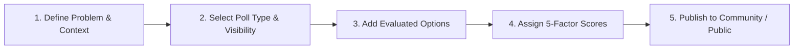

# DecisionHub — Comprehensive User & Evaluator Guide

> **Welcome to DecisionHub**: The collaborative decision intelligence system engineered for structured option analysis, multi-criteria trade-off evaluation, and high-engagement community consensus.

---

## 1. System Overview & Core Philosophy

DecisionHub transforms unstructured discussions and chaotic polls into structured, quantifiable, and transparent decision-making processes. Whether your team is choosing cloud infrastructure, prioritizing product features, or determining company policies, DecisionHub delivers:
- **5-Factor Multi-Criteria Scoring**: Quantitative evaluation across Cost, Benefits, Risk, Time, and Convenience.
- **Flexible Voting Mechanisms**: Single Choice, Multiple Choice, and Star/Numeric Ratings (1–5).
- **Community Governance**: Scoped collaborative spaces with Owner, Moderator, and Member roles.
- **Deep Collaboration**: Threaded discussions, nested replies, emoji reactions, and structured suggestions.
- **Accountability & Moderation**: Content reporting, comment hiding, and audit-ready resolution workflows.
- **Decision Intelligence Analytics**: Real-time aggregated insights, category distributions, and activity heatmaps.

---

## 2. Pre-Configured Personas & Quick Login

For evaluation and testing, DecisionHub includes pre-seeded accounts populated with realistic data:

| Persona Role | User Name | Login Email | Password | Primary Responsibilities |
| :--- | :--- | :--- | :--- | :--- |
| **Global Admin** | System Admin | `admin@decisionhub.local` | `demo123` | Platform governance, system notifications, universal moderation, security audits |
| **Community Moderator** | Arjun Mehta | `arjun@decisionhub.local` | `demo123` | Manages *Engineering Circle*, moderates *Product Builders*, reviews flagged reports |
| **Community Owner** | Maya Patel | `maya@decisionhub.local` | `demo123` | Directs *Product Builders* & *Weekend Explorers*, invites team members, promotes moderators |
| **Active Member** | Harish | `harish@decisionhub.local` | `demo123` | Participates in decision voting, submits suggestions, collaborates in threaded discussions |
| **Collaborator** | Priya Nair | `priya@decisionhub.local` | `demo123` | Leads *Workplace & Culture*, reviews team suggestions and feedback |
| **Collaborator** | Rohan Shah | `rohan@decisionhub.local` | `demo123` | Leads *Sustainable Choices*, authors environmental decision boards |

> [!TIP]
> You can also explore the entire application with interactive sample data in zero-setup mode by visiting the `/demo` route directly from the top navigation bar!

---

## 3. Step-by-Step Feature Walkthrough

### 3.1 Authentication & Profile Management
1. **Registration**: Navigate to `/register`, enter your Full Name, Email, and Password. Upon submission, an authenticated JWT session is created immediately.
2. **Login**: Navigate to `/login`, enter your credentials, and click **Sign In**.
3. **Password Recovery**: If credentials are forgotten, click *Forgot Password?* on the login page. Enter your registered email address. If SMTP is configured, a password reset link with a secure SHA-256 token will be delivered to your inbox.
4. **Session Management**: Sessions remain active for 24 hours. The application header displays your current role badge (`ADMIN` or `USER`) and unread notification bell.

---

### 3.2 Dashboard Navigation
The main Dashboard (`/dashboard`) provides a command-center view of your active initiatives:
- **Quick Metric Cards**: Total decisions authored, active communities joined, and pending invitations.
- **Recent Decisions**: Immediate access to your newest boards and their real-time vote tallies.
- **Notification Center**: Real-time alerts for incoming votes, replies, and community invitations.

---

### 3.3 Creating a Decision Board
Navigate to **Create Board** (`/decisions/create`) to initiate a new analysis:

1. **Title & Description**: Provide a succinct objective (e.g. *"Cloud Database Provider Shortlist"*) and markdown background narrative.
2. **Category**: Select a classification (e.g., *Technology*, *Product*, *Operations*, *Culture*, *Finance*).
3. **Visibility**:
   - `PUBLIC`: Accessible by all registered platform users.
   - `COMMUNITY`: Restricted exclusively to enrolled members of a designated community.
4. **Poll Type**:
   - `SINGLE_CHOICE`: Each participant selects exactly one preferred option.
   - `MULTIPLE_CHOICE`: Voters can endorse multiple acceptable options simultaneously.
   - `RATING`: Voters assign a quality score from 1 to 5 stars for each alternative.
5. **Anonymous Voting**: Toggle on if voter identities should remain concealed on the ballot ledger.
6. **Options & 5-Factor Scoring**:
   - Add two or more options (e.g., *Option A: Amazon Aurora*, *Option B: Cloud SQL*).
   - Outline key **Pros** and **Cons**.
   - Input numerical factor scores (scale 1 to 10):
     - **Cost**: Budget impact and licensing efficiency.
     - **Benefits**: Expected performance, upside, and value creation.
     - **Risk**: Operational exposure and migration risks.
     - **Time**: Deployment timeline and implementation velocity.
     - **Convenience**: Ease of maintenance and user experience.
7. Click **Create Decision Board** to publish.

---

### 3.4 Evaluating & Voting on Decision Boards
Open any board from the **Boards** catalog (`/decisions`) to inspect the evaluation interface:
- **Comparison Grid**: View options side-by-side with their computed multi-factor composite scores, pros/cons, and real-time community vote percentages.
- **Casting Your Ballot**:
  - For single or multi-choice: Click the **Vote** button beside your selected alternative.
  - For rating polls: Select a star rating between 1 and 5.
  - The live vote tally and percentage distribution recalculate immediately.
- **Vote Retraction**: Click **Retract Vote** at any time before the board closes to withdraw or revise your vote.
- **Board Lifecycle Control**: If you are the board owner or an Admin, toggle **Close Voting** to lock the results and publish final outcomes.

---

### 3.5 Threaded Collaboration & Suggestions
- **Threaded Comments**: On any decision board, scroll to the **Discussion** section. Post comments with rich context.
- **Nested Replies**: Click **Reply** on any comment to start an indented sub-thread addressing specific arguments.
- **Reactions**: Click the reaction thumbs-up to endorse constructive feedback.
- **Structured Suggestions**: Use the **Suggestions** tab to submit concrete improvements or amendments directly to the board owner.

---

### 3.6 Communities & Governance
Access **Communities** (`/communities`) to collaborate in dedicated organizational units:
1. **Browse & Join**: Explore existing communities (*Engineering Circle*, *Product Builders*, *Workplace & Culture*). Click **Join Community** to participate in scoped private decisions.
2. **Create Community**: Create a dedicated space for your team or working group. The creator is automatically designated as **OWNER**.
3. **Member Management**:
   - Invite colleagues by entering their email address.
   - As an Owner or Admin, promote trusted members to **MODERATOR** or transfer ownership.
4. **Community Scoped Decisions**: Create boards bound exclusively to community members to protect proprietary discussions.

---

### 3.7 Platform Discussion Forum
Navigate to **Forum** (`/discussions`) for platform-wide dialogue:
- Create open discussion threads unrelated to a specific decision board.
- Post responses and nested comments to cultivate organizational alignment.

---

### 3.8 Analytics & Decision Insights
Visit **Analytics** (`/analytics`) to inspect data-driven platform metrics:
- **Global Overview**: Total decision boards authored, total ballots cast, comment activity, and active communities.
- **Category Vote Share**: Distribution charts displaying which domains command the highest organizational focus.
- **Poll Type Preference**: Usage breakdown across Single Choice, Multiple Choice, and Rating polls.
- **Decision Outcomes**: Real-time ratio of active deliberations versus finalized/closed decisions.
- **Top Active Boards**: Ranked leaderboard highlighting initiatives with the highest community engagement.

---

### 3.9 Moderation & Community Safety
DecisionHub enforces robust moderation mechanisms to ensure constructive communication:
1. **Flagging Content**: Any user can click **Report** on an inappropriate decision board or abusive comment, specifying a detailed justification.
2. **Moderator Portal** (`/reports`):
   - Scoped to Community Moderators and Global Admins (regular members receive `403 Forbidden`).
   - Displays all pending moderation flags with direct links to the flagged content and reporter information.
3. **Enforcement Actions**:
   - **Hide Comment**: Instantly suppresses toxic or offensive comments from public view.
   - **Resolve Report**: Marks the report as investigated and resolved.
   - **Dismiss Report**: Clears unwarranted reports with an audit log.

---

### 3.10 User Feedback Channel
Navigate to **Feedback** (`/feedback`) to submit product improvement requests or process suggestions:
- All users can track the review lifecycle of their submitted items (`OPEN` → `REVIEWED` → `RESOLVED`).
- Administrators and Moderators can triage feedback items and post status updates.

---

## 4. Best Practices for High-Impact Decision Intelligence

1. **Deconstruct Complex Decisions**: When presenting multi-option choices, provide quantitative ratings for all 5 factors (Cost, Benefits, Risk, Time, Convenience) rather than just pros and cons.
2. **Select the Right Poll Type**:
   - Use **RATING (1-5)** during early exploration to measure sentiment across each option independently.
   - Use **SINGLE_CHOICE** when closing an initiative to drive decisive consensus.
3. **Foster Safe Dialogue with Anonymous Voting**: For sensitive topics or organizational feedback, enable *Allow Anonymous Voting* to eliminate bias and encourage honest participation.
4. **Set Clear Decision Deadlines**: Announce voting deadlines in the description and close the board promptly to formalize organizational commitment.
